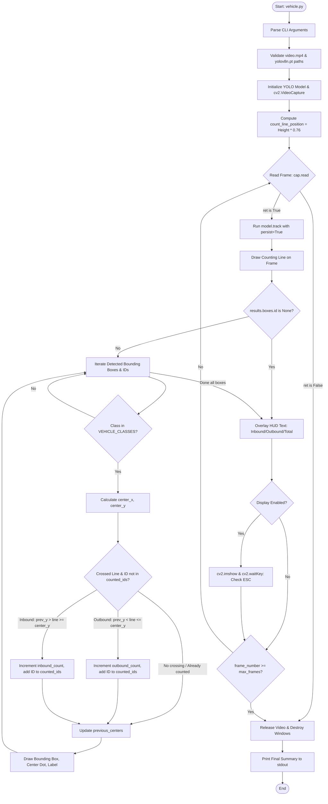

# Technical Code Audit Report: Traffic Vehicle Counter

**Repository:** `https://github.com/Rahulkumar0029/traffic-vehicle-counter`  
**Auditor:** Senior Software Engineer  
**Date:** October 2026  
**Scope:** Complete repository audit of the existing codebase as-is.

---

## 1. Project Overview

The **Traffic Vehicle Counter** is a lightweight, single-script Python application designed to detect, track, and directionally count vehicles from recorded video footage using an Ultralytics YOLOv8 Nano model and OpenCV.

### Plain-Language Summary
The application processes a video frame by frame. On each frame, it detects objects belonging to common road vehicle categories, tracks them across consecutive frames with unique tracking IDs, and checks if a vehicle's center point crosses a horizontal counting line positioned near the bottom of the frame. Depending on whether the vehicle crossed moving downwards or upwards, it classifies the event as an **outbound** or **inbound** count. An OpenCV graphical window renders the video stream in real-time with annotated bounding boxes, object labels, tracking IDs, the counting line, and a live Heads-Up Display (HUD) showing current counts.

### Current Inputs and Outputs

| Category | Medium / Format | Supported in Existing Code? | Implementation Details / References |
| :--- | :--- | :--- | :--- |
| **Input** | Recorded video file (`.mp4`, etc.) | **Yes** (Default) | Passed via CLI `--video` (default: `video.mp4`). Validated at [`vehicle.py:L29-30`](file:///c:/Users/rahul/OneDrive/Desktop/Projects/Traffic/vehicle.py#L29-L30). |
| **Input** | Webcam / USB camera index (`0`, `1`) | **No** | Blocked by path validation: `if not video_path.is_file(): raise FileNotFoundError(...)` at [`vehicle.py:L29-30`](file:///c:/Users/rahul/OneDrive/Desktop/Projects/Traffic/vehicle.py#L29-L30). |
| **Input** | RTSP / HTTP network stream | **No** | Blocked by `video_path.is_file()` check at [`vehicle.py:L29-30`](file:///c:/Users/rahul/OneDrive/Desktop/Projects/Traffic/vehicle.py#L29-L30). |
| **Input** | Static image files / directories | **No** | Code expects a video stream handled via `cv2.VideoCapture` loop. |
| **Output** | Real-time GUI window | **Yes** | OpenCV window titled `"Vehicle Detection & Counting"` via `cv2.imshow` ([`vehicle.py:L104`](file:///c:/Users/rahul/OneDrive/Desktop/Projects/Traffic/vehicle.py#L104)). |
| **Output** | Headless console output | **Yes** | Enabled via `--no-display` flag ([`vehicle.py:L15`](file:///c:/Users/rahul/OneDrive/Desktop/Projects/Traffic/vehicle.py#L15)), prints counts to `stdout`. |
| **Output** | Saved annotated video file | **No** | No `cv2.VideoWriter` exists in the repository. Frames are discarded after display. |
| **Output** | CSV / Excel export | **No** | No CSV writing logic exists. |
| **Output** | SQL / NoSQL database | **No** | No database integration or ORM exists. |
| **Output** | Web dashboard / API | **No** | No web server, REST API, or frontend framework exists. |
| **Output** | Log files on disk | **No** | No file-based logging (`logging` module) is implemented; only raw `print()` calls. |

---

## 2. Tech Stack

### Language and Runtime
- **Language:** Python
- **Recommended Version:** Python 3.11 (as documented in [`README.md:L28`](file:///c:/Users/rahul/OneDrive/Desktop/Projects/Traffic/README.md#L28)).
- **Compatibility Tested:** Verified operational on Python 3.14.0b1 (Windows 64-bit environment).

### Dependencies and Frameworks

| Library / Module | Source | Required / Implicit | Version (Environment Tested) | Purpose |
| :--- | :--- | :--- | :--- | :--- |
| `ultralytics` | External PyPI package | Explicit import ([`vehicle.py:L5`](file:///c:/Users/rahul/OneDrive/Desktop/Projects/Traffic/vehicle.py#L5)) | `8.4.150` | YOLOv8 model loading, inference, and multi-object tracking backend. |
| `opencv-python` (`cv2`) | External PyPI package | Explicit import ([`vehicle.py:L4`](file:///c:/Users/rahul/OneDrive/Desktop/Projects/Traffic/vehicle.py#L4)) | `5.0.0` / `4.x` | Video frame decoding (`cv2.VideoCapture`), geometric drawing, HUD text, GUI display. |
| `torch` | Dependency of Ultralytics | Implicit package | `2.14.0+cpu` | Neural network runtime for YOLOv8 inference. |
| `lap` / `lapx` | Dependency of Ultralytics | Runtime dependency | `0.5.13` | Linear Assignment Problem solver used internally by Ultralytics tracker algorithms. |
| `argparse` | Python Standard Library | Explicit import ([`vehicle.py:L1`](file:///c:/Users/rahul/OneDrive/Desktop/Projects/Traffic/vehicle.py#L1)) | Built-in | CLI argument parsing. |
| `pathlib` | Python Standard Library | Explicit import ([`vehicle.py:L2`](file:///c:/Users/rahul/OneDrive/Desktop/Projects/Traffic/vehicle.py#L2)) | Built-in | File path resolution and validation. |

> [!IMPORTANT]
> **Dependency Manifest Status:** The repository contains **NO** `requirements.txt`, `setup.py`, `pyproject.toml`, or `Pipfile`. Dependencies must be inferred from `README.md` or imports.

### Hardware Assumptions
- **Default Device:** CPU execution.
- **GPU Acceleration:** `vehicle.py` does not explicitly pass a `device` parameter to `model.track()`. Ultralytics defaults to CUDA if an NVIDIA GPU and CUDA-enabled PyTorch build are present, otherwise falling back to CPU (`torch.cuda.is_available() == False`).

---

## 3. Folder and File Structure

### Tree View
```text
traffic-vehicle-counter/
├── .git/               # Git version control metadata (main branch, 3 commits)
├── README.md           # Documentation: project overview, CLI flags, install steps, and scope notes
├── vehicle.py          # Primary application script containing all detection, tracking, counting, and GUI logic
├── video.mp4           # Bundled sample input video (1280x720, 29.97 fps, 5396 frames, 6.34 MB)
└── yolov8n.pt          # Bundled pre-trained YOLOv8 Nano PyTorch model checkpoint (6.25 MB)
```

### Detailed Purpose of Every File

| File Name | Size | Purpose |
| :--- | :--- | :--- |
| [`README.md`](file:///c:/Users/rahul/OneDrive/Desktop/Projects/Traffic/README.md) | 3,359 bytes (120 lines) | Describes project features, counting direction theory, setup commands, CLI arguments, and current architectural scope. |
| [`vehicle.py`](file:///c:/Users/rahul/OneDrive/Desktop/Projects/Traffic/vehicle.py) | 5,173 bytes (124 lines) | The sole executable code file. Implements command-line arguments, YOLO model tracking, line crossing detection, directional state counting, and OpenCV rendering. |
| `video.mp4` | 6,648,163 bytes | Test video recording showing road traffic from an elevated camera perspective (1280x720 resolution, 29.97 fps, 5,396 frames, ~180 seconds). |
| `yolov8n.pt` | 6,549,796 bytes | Official pre-trained Ultralytics YOLOv8 Nano object detection model checkpoint trained on the 80-class COCO dataset. |

---

## 4. End-to-End Workflow

### Step-by-Step Execution Sequence

1. **CLI Argument Parsing ([`vehicle.py:L11-17`](file:///c:/Users/rahul/OneDrive/Desktop/Projects/Traffic/vehicle.py#L11-17)):**
   - Parses `--video`, `--model`, `--no-display`, and `--max-frames`.
2. **Path Resolution & Validation ([`vehicle.py:L22-30`](file:///c:/Users/rahul/OneDrive/Desktop/Projects/Traffic/vehicle.py#L22-L30)):**
   - Resolves paths relative to the script's directory (`base_dir`) if relative paths were supplied.
   - Asserts existence via `.is_file()`, raising `FileNotFoundError` if either file is absent.
3. **Model & Video Stream Initialization ([`vehicle.py:L32-35`](file:///c:/Users/rahul/OneDrive/Desktop/Projects/Traffic/vehicle.py#L32-L35)):**
   - Instantiates `model = YOLO(str(model_path))`.
   - Opens video via `cap = cv2.VideoCapture(str(video_path))` and checks `cap.isOpened()`.
4. **State & Geometry Setup ([`vehicle.py:L37-45`](file:///c:/Users/rahul/OneDrive/Desktop/Projects/Traffic/vehicle.py#L37-L45)):**
   - Calculates virtual counting line Y-position: `count_line_position = int(cap.get(cv2.CAP_PROP_FRAME_HEIGHT) * 0.76)`.
   - Initializes integer counters (`inbound_count = 0`, `outbound_count = 0`).
   - Initializes tracking dictionaries (`inbound_counts = {}`, `outbound_counts = {}`, `previous_centers = {}`).
   - Initializes deduplication set (`counted_ids = set()`).
5. **Frame Processing Loop ([`vehicle.py:L48-109`](file:///c:/Users/rahul/OneDrive/Desktop/Projects/Traffic/vehicle.py#L48-L109)):**
   - **Read Frame:** `ret, frame = cap.read()`. If `ret` is False (end of stream), breaks loop.
   - **Track Objects:** Calls `results = model.track(frame, persist=True, verbose=False)[0]`.
   - **Draw Virtual Line:** Renders line from `(25, count_line_position)` to `(width - 25, count_line_position)` in cyan/blue (`BGR: (255, 127, 0)`).
   - **Process Tracked Detections:**
     - Checks if `results.boxes.id is not None`.
     - Extracts `track_id = int(raw_track_id.item())`, class ID `cls_id`, and class label `model.names[cls_id]`.
     - Skips detection if `label not in VEHICLE_CLASSES`.
     - Computes bounding box center point: `center_x = (x1 + x2) // 2`, `center_y = (y1 + y2) // 2`.
     - **Directional Crossing Evaluation:**
       - Compares `previous_y` from `previous_centers.get(track_id)` against `count_line_position` and current `center_y`.
       - If `previous_y < count_line_position <= center_y`: sets `direction = "outbound"`.
       - If `previous_y > count_line_position >= center_y`: sets `direction = "inbound"`.
     - **Counting & Deduplication:**
       - If `track_id not in counted_ids` and `direction is not None`: adds `track_id` to `counted_ids`, increments direction counter, updates per-class dict, and logs count to terminal.
     - **State & Visual Update:**
       - Updates `previous_centers[track_id] = center_y`.
       - Draws bounding box (yellow if counted, green if uncounted), red center circle, and text label `"{label} #{track_id}"`.
   - **Render HUD Overlay ([`vehicle.py:L95-101`](file:///c:/Users/rahul/OneDrive/Desktop/Projects/Traffic/vehicle.py#L95-L101)):**
     - Draws `INBOUND: {inbound_count}`, `OUTBOUND: {outbound_count}`, and `TOTAL: {total_count}` on top-left of frame.
   - **Display / User Input:**
     - If not `--no-display`, renders frame with `cv2.imshow()`. Checks for `Esc` key (ASCII 27) via `cv2.waitKey(1)` to break.
   - **Frame Limit Check:** If `--max-frames` was set and reached, breaks loop.
6. **Teardown & Final Reporting ([`vehicle.py:L110-120`](file:///c:/Users/rahul/OneDrive/Desktop/Projects/Traffic/vehicle.py#L110-L120)):**
   - Releases video capture handle (`cap.release()`) and closes OpenCV windows (`cv2.destroyAllWindows()`).
   - Prints final aggregated counts to terminal.

### Workflow Diagram



---

## 5. Detection

### Model Configuration

| Property | Value in Existing Project | Reference |
| :--- | :--- | :--- |
| **Model Architecture** | YOLOv8 Nano (`yolov8n`) | [`vehicle.py:L14`](file:///c:/Users/rahul/OneDrive/Desktop/Projects/Traffic/vehicle.py#L14), [`README.md:L29`](file:///c:/Users/rahul/OneDrive/Desktop/Projects/Traffic/README.md#L29) |
| **Weights File** | `yolov8n.pt` (local file, 6.25 MB) | Root directory |
| **Model Loading Method** | `model = YOLO(str(model_path))` | [`vehicle.py:L32`](file:///c:/Users/rahul/OneDrive/Desktop/Projects/Traffic/vehicle.py#L32) |
| **Inference Call** | `model.track(frame, persist=True, verbose=False)` | [`vehicle.py:L54`](file:///c:/Users/rahul/OneDrive/Desktop/Projects/Traffic/vehicle.py#L54) |
| **Confidence Threshold (`conf`)** | Unspecified / Default (`0.25` / `0.1` tracking default) | Inherited from Ultralytics runtime |
| **NMS IoU Threshold (`iou`)** | Unspecified / Default (`0.7`) | Inherited from Ultralytics runtime |
| **Input Image Size (`imgsz`)** | Unspecified / Default (`640`) | Inherited from Ultralytics runtime |

### Classes Detected and Filtered

The underlying model checkpoint `yolov8n.pt` contains all 80 standard COCO dataset classes. Vehicle filtering occurs strictly post-inference in Python code:

```python
# Defined at vehicle.py:L8
VEHICLE_CLASSES = {"car", "bus", "truck", "motorbike", "motorcycle", "bicycle"}
```

#### Class Extraction and Filtering Logic ([`vehicle.py:L61-64`](file:///c:/Users/rahul/OneDrive/Desktop/Projects/Traffic/vehicle.py#L61-L64)):
```python
cls_id = int(box.cls[0].item())
label = model.names[cls_id]
if label not in VEHICLE_CLASSES:
    continue
```

> [!NOTE]
> In standard COCO annotations (and `model.names`), class `3` is labeled `"motorcycle"`. The set in `vehicle.py:L8` includes both `"motorbike"` and `"motorcycle"`. `"motorbike"` is redundant for COCO YOLOv8 models, serving as a fallback for older models or Pascal VOC-derived label sets.

---

## 6. Tracking

### Tracking Framework & Implementation
- **Underlying Tracking Method:** Ultralytics multi-object tracking engine.
- **Algorithm Used:** Configured via Ultralytics default tracker (typically BoT-SORT / TrackTrack using a Kalman filter and Linear Assignment Problem solver). The repository does not supply a custom tracker YAML configuration file; it uses Ultralytics defaults out of the box.
- **Invocation:**
  ```python
  # vehicle.py:L54
  results = model.track(frame, persist=True, verbose=False)[0]
  ```
  The parameter `persist=True` instructs the tracker to preserve track states and Kalman filter tracks between consecutive video frames.

### Track ID Extraction & Lifecycle Management
1. **Extraction ([`vehicle.py:L58-60`](file:///c:/Users/rahul/OneDrive/Desktop/Projects/Traffic/vehicle.py#L58-L60)):**
   - The script verifies whether track IDs were generated: `if results.boxes.id is not None:`.
   - Individual track IDs are extracted via: `track_id = int(raw_track_id.item())`.
2. **State Dictionaries Maintained by Script:**
   - `previous_centers`: Python `dict` mapping `int(track_id) -> int(center_y)`.
   - `counted_ids`: Python `set` storing IDs of vehicles that have completed a line crossing.

---

## 7. Counting Logic

### Virtual Line Geometry & Coordinate Space
- **Counting Geometry:** A single horizontal virtual line across the frame.
- **Y-Coordinate Calculation ([`vehicle.py:L37`](file:///c:/Users/rahul/OneDrive/Desktop/Projects/Traffic/vehicle.py#L37)):**
  ```python
  count_line_position = int(cap.get(cv2.CAP_PROP_FRAME_HEIGHT) * 0.76)
  ```
  For the sample 720p video (`height = 720`), `count_line_position = int(720 * 0.76) = 547`.
- **Drawn Visual Line ([`vehicle.py:L56`](file:///c:/Users/rahul/OneDrive/Desktop/Projects/Traffic/vehicle.py#L56)):**
  Drawn from `(25, 547)` to `(frame_width - 25, 547)`.

### Direction Calculation Logic ([`vehicle.py:L70-75`](file:///c:/Users/rahul/OneDrive/Desktop/Projects/Traffic/vehicle.py#L70-L75))

For each vehicle in the current frame, its vertical centroid `center_y = (y1 + y2) // 2` is compared with its previous centroid `previous_y = previous_centers.get(track_id)`:

```python
direction = None
if previous_y is not None:
    if previous_y < count_line_position <= center_y:
        direction = "outbound"
    elif previous_y > count_line_position >= center_y:
        direction = "inbound"
```

- **Outbound (Downward Motion):** Vehicle centroid in previous frame was strictly above the line (`< 547`) and current centroid is at or below the line (`>= 547`).
- **Inbound (Upward Motion):** Vehicle centroid in previous frame was strictly below the line (`> 547`) and current centroid is at or above the line (`<= 547`).

### Double Counting Prevention ([`vehicle.py:L77-78`](file:///c:/Users/rahul/OneDrive/Desktop/Projects/Traffic/vehicle.py#L77-L78))
```python
if track_id not in counted_ids and direction is not None:
    counted_ids.add(track_id)
```
- Each vehicle `track_id` is added to the `counted_ids` set upon its first valid crossing.
- If the vehicle remains in frame or oscillates near the line in subsequent frames, `track_id not in counted_ids` evaluates to `False`, suppressing any additional count increments.

### Per-Class Counting Behavior
- Per-class counts are recorded in memory in dictionaries at lines 81 and 84:
  ```python
  outbound_counts[label] = outbound_counts.get(label, 0) + 1
  inbound_counts[label] = inbound_counts.get(label, 0) + 1
  ```
- **Observed Deficiency:** These dictionaries are **never printed, never rendered to the HUD, and never exported**. They are abandoned when `main()` exits.

---

## 8. Configuration

Every hardcoded parameter, threshold, style, and path in the codebase is cataloged below:

| Parameter / Value | File Name & Line Number | Description / Impact |
| :--- | :--- | :--- |
| `{"car", "bus", "truck", "motorbike", "motorcycle", "bicycle"}` | [`vehicle.py:L8`](file:///c:/Users/rahul/OneDrive/Desktop/Projects/Traffic/vehicle.py#L8) | Allowed vehicle class names for filtering. |
| `default=Path("video.mp4")` | [`vehicle.py:L13`](file:///c:/Users/rahul/OneDrive/Desktop/Projects/Traffic/vehicle.py#L13) | Default input video file path. |
| `default=Path("yolov8n.pt")` | [`vehicle.py:L14`](file:///c:/Users/rahul/OneDrive/Desktop/Projects/Traffic/vehicle.py#L14) | Default model weights file path. |
| `default=0` | [`vehicle.py:L16`](file:///c:/Users/rahul/OneDrive/Desktop/Projects/Traffic/vehicle.py#L16) | Default max frames to process (`0` = process entire video). |
| `0.76` | [`vehicle.py:L37`](file:///c:/Users/rahul/OneDrive/Desktop/Projects/Traffic/vehicle.py#L37) | Counting line height multiplier (76% of frame height). |
| `"Vehicle Detection & Counting"` | [`vehicle.py:L45`](file:///c:/Users/rahul/OneDrive/Desktop/Projects/Traffic/vehicle.py#L45) | OpenCV display window title. |
| `(25, count_line_position)` to `(frame_width - 25, ...)` | [`vehicle.py:L56`](file:///c:/Users/rahul/OneDrive/Desktop/Projects/Traffic/vehicle.py#L56) | Horizontal coordinates for drawing the counting line. |
| `(255, 127, 0)`, thickness `3` | [`vehicle.py:L56`](file:///c:/Users/rahul/OneDrive/Desktop/Projects/Traffic/vehicle.py#L56) | Counting line color (BGR) and thickness. |
| `(0, 255, 255)` vs `(0, 255, 0)` | [`vehicle.py:L89`](file:///c:/Users/rahul/OneDrive/Desktop/Projects/Traffic/vehicle.py#L89) | Bounding box colors: Yellow (counted) vs Green (uncounted). |
| Bounding box thickness `2` | [`vehicle.py:L90`](file:///c:/Users/rahul/OneDrive/Desktop/Projects/Traffic/vehicle.py#L90) | Rectangle border thickness. |
| Circle radius `4`, `(0, 0, 255)`, thickness `-1` | [`vehicle.py:L91`](file:///c:/Users/rahul/OneDrive/Desktop/Projects/Traffic/vehicle.py#L91) | Centroid circle radius, red BGR color, filled. |
| Font scale `0.7`, thickness `2` | [`vehicle.py:L93`](file:///c:/Users/rahul/OneDrive/Desktop/Projects/Traffic/vehicle.py#L93) | Label text styling above vehicle bounding box. |
| `(30, 45)`, scale `0.9`, color `(255, 100, 0)` | [`vehicle.py:L96-97`](file:///c:/Users/rahul/OneDrive/Desktop/Projects/Traffic/vehicle.py#L96-L97) | HUD Inbound count position, scale, and BGR color. |
| `(30, 80)`, scale `0.9`, color `(0, 180, 255)` | [`vehicle.py:L98-99`](file:///c:/Users/rahul/OneDrive/Desktop/Projects/Traffic/vehicle.py#L98-L99) | HUD Outbound count position, scale, and BGR color. |
| `(30, 115)`, scale `1.5`, color `(0, 0, 255)` | [`vehicle.py:L100-101`](file:///c:/Users/rahul/OneDrive/Desktop/Projects/Traffic/vehicle.py#L100-L101) | HUD Total count position, scale, and red BGR color. |
| `cv2.waitKey(1) & 0xFF == 27` | [`vehicle.py:L105`](file:///c:/Users/rahul/OneDrive/Desktop/Projects/Traffic/vehicle.py#L105) | 1ms delay for key input; ASCII 27 represents `Esc` key. |

---

## 9. Data and Storage

- **Datasets:** None included in the repository. No dataset training manifests, annotations, or splits exist.
- **Sample Video Data:**
  - File: `video.mp4`
  - Dimensions: 1280 × 720 px
  - Framerate: 29.9700 FPS
  - Total Frames: 5,396 frames (duration: ~179.98 seconds)
  - Content: Elevated camera view overlooking multi-lane roadway traffic.
- **Saved Outputs:** None. The project writes zero output files to disk during or after execution.
- **Persistence:**
  - Databases: None.
  - CSV / Structured Files: None.
  - Runtime Logging: Standard output (`stdout`) only.

---

## 10. User Interface

The application provides two interfaces: a Graphical User Interface (GUI) and a Command-Line Interface (CLI).

### 1. Graphical User Interface (OpenCV Window)
- Managed via `cv2.imshow("Vehicle Detection & Counting", frame)` ([`vehicle.py:L104`](file:///c:/Users/rahul/OneDrive/Desktop/Projects/Traffic/vehicle.py#L104)).
- Renders bounding boxes, class labels with IDs, the crossing line, and the HUD in the top-left corner.
- Keybinding: Pressing `Esc` halts processing and closes the window.

### 2. Command-Line Interface (CLI)
Built using `argparse.ArgumentParser` ([`vehicle.py:L11-17`](file:///c:/Users/rahul/OneDrive/Desktop/Projects/Traffic/vehicle.py#L11-L17)):

```text
usage: vehicle.py [-h] [--video VIDEO] [--model MODEL] [--no-display] [--max-frames MAX_FRAMES]

Count vehicles crossing a line in a video.

options:
  -h, --help            show this help message and exit
  --video VIDEO         Video input path. Default: video.mp4
  --model MODEL         YOLO model path. Default: yolov8n.pt
  --no-display          Disable the OpenCV display window
  --max-frames MAX_FRAMES Stop after N frames. Useful for testing (0 = unlimited)
```

### Exact Run Commands
- **Standard Run (GUI Window):**
  ```powershell
  python vehicle.py
  ```
- **Headless Mode (Server / Cloud / CLI-only):**
  ```powershell
  python vehicle.py --no-display
  ```
- **Bounded Test Run (e.g., 300 frames):**
  ```powershell
  python vehicle.py --max-frames 300 --no-display
  ```
- **Custom Model and Video:**
  ```powershell
  python vehicle.py --video "path/to/custom_video.mp4" --model "path/to/custom_model.pt"
  ```

---

## 11. How to Run & Verification

### Documented Installation Steps in README

```bash
git clone https://github.com/Rahulkumar0029/traffic-vehicle-counter.git
cd traffic-vehicle-counter
python -m pip install ultralytics opencv-python
```

### Actual Verification Results

1. **Missing Tracking Dependency (`lap`):**
   - When running `model.track()` with default tracking settings, Ultralytics detects that the linear assignment problem solver `lap` is not installed by default with `pip install ultralytics`.
   - On the initial run, Ultralytics triggers an automatic network download:
     `requirements: Ultralytics requirement ['lap>=0.5.12'] not found, attempting AutoUpdate...`
   - In an air-gapped, offline, or restricted-permissions environment, this auto-install fails, which crashes the script.
2. **Discrepancy in README Claimed Output:**
   - In [`README.md:L74-78`](file:///c:/Users/rahul/OneDrive/Desktop/Projects/Traffic/README.md#L74-L78), the documentation states:
     ```text
     Inbound vehicles: 3
     Outbound vehicles: 8
     Total vehicles: 11
     Finished: 300 frames processed.
     ```
   - Actual test execution with `python vehicle.py --no-display --max-frames 300` produced:
     ```text
     Vehicle counted (outbound, car): 1
     Vehicle counted (outbound, car): 2
     Vehicle counted (outbound, car): 3
     Vehicle counted (outbound, car): 4
     Vehicle counted (outbound, car): 5
     Vehicle counted (outbound, car): 6
     Vehicle counted (outbound, car): 7
     Vehicle counted (outbound, car): 8
     Vehicle counted (inbound, car): 9
     Vehicle counted (inbound, car): 10
     Inbound vehicles: 2
     Outbound vehicles: 8
     Total vehicles: 10
     Finished: 300 frames processed.
     ```
   - **Reason:** Minor variations in tracker assignment heuristics between Ultralytics versions affect detection on marginal boundary frames.

---

## 12. Limitations and Problems in Current Code

### 1. Inability to Ingest RTSP Streams or Live Webcams
[`vehicle.py:L29-30`](file:///c:/Users/rahul/OneDrive/Desktop/Projects/Traffic/vehicle.py#L29-L30) explicitly requires the input to be an existing filesystem path:
```python
if not video_path.is_file():
    raise FileNotFoundError(f"Video file not found: {video_path}")
```
Passing an RTSP URL (`rtsp://192.168.1.100/stream`) or a numeric webcam index (`0`) triggers a `FileNotFoundError` or type error before `cv2.VideoCapture` is ever called.

### 2. Disconnect Between Visual Line and Mathematical Crossing Check
In [`vehicle.py:L56`](file:///c:/Users/rahul/OneDrive/Desktop/Projects/Traffic/vehicle.py#L56), the line is drawn with horizontal margins:
```python
cv2.line(frame, (25, count_line_position), (frame_width - 25, count_line_position), ...)
```
However, the crossing detection logic at [`vehicle.py:L72-75`](file:///c:/Users/rahul/OneDrive/Desktop/Projects/Traffic/vehicle.py#L72-L75) checks **only** the Y-axis coordinate:
```python
if previous_y < count_line_position <= center_y:
    direction = "outbound"
elif previous_y > count_line_position >= center_y:
    direction = "inbound"
```
There is no check validating whether `center_x` is between `25` and `frame_width - 25`. Any vehicle crossing anywhere across the entire width of the frame is counted, regardless of the line segment coordinates shown on screen.

### 3. Memory Leak in Long-Running Executions (`previous_centers`)
The dictionary `previous_centers` ([`vehicle.py:L43`](file:///c:/Users/rahul/OneDrive/Desktop/Projects/Traffic/vehicle.py#L43)) continuously stores Y-coordinates for every `track_id` encountered:
```python
previous_centers[track_id] = center_y  # Line 88
```
There is no eviction mechanism, TTL, or cleanup for track IDs that have exited the scene. In continuous operation or long video streams, this dictionary grows indefinitely.

### 4. Loss of Per-Class Data
The script initializes and populates per-class tracking dictionaries:
```python
inbound_counts[label] = inbound_counts.get(label, 0) + 1   # Line 81
outbound_counts[label] = outbound_counts.get(label, 0) + 1  # Line 84
```
However, at the conclusion of the video ([`vehicle.py:L115-119`](file:///c:/Users/rahul/OneDrive/Desktop/Projects/Traffic/vehicle.py#L115-L119)), the script only prints total inbound and outbound sums. The fine-grained counts by vehicle type (cars, buses, trucks, motorcycles) are discarded.

### 5. Lack of Video Recording or Export
The processed frames with drawn bounding boxes, lines, and HUD text are never written to disk. The application lacks a `cv2.VideoWriter` pipeline.

### 6. Vulnerability to Tracker ID Switches
If a vehicle is occluded (e.g., passing behind a large truck) or temporarily lost by YOLO and the tracker re-assigns a new `track_id` upon re-detection, the new ID is not in `counted_ids` and will be counted a second time if it crosses the line.

### 7. Hardcoded Perspective Geometry
The counting line position is hardcoded to a fixed ratio of 76% of frame height ([`vehicle.py:L37`](file:///c:/Users/rahul/OneDrive/Desktop/Projects/Traffic/vehicle.py#L37)). This makes the counter fragile to variations in camera tilt, elevation, and lane layout.

### 8. Missing Project Infrastructure
- No `requirements.txt` or `pyproject.toml`.
- No unit tests or integration tests.
- No CI/CD workflow configuration (e.g., GitHub Actions).
- No Docker containerization.

---

## 13. Reusable Parts

The following sections and patterns in [`vehicle.py`](file:///c:/Users/rahul/OneDrive/Desktop/Projects/Traffic/vehicle.py) represent generic logic that could be decoupled into standalone modules:

| Component | Code Reference | Description / Reuse Utility |
| :--- | :--- | :--- |
| **CLI Parameter Parser** | [`vehicle.py:L11-17`](file:///c:/Users/rahul/OneDrive/Desktop/Projects/Traffic/vehicle.py#L11-L17) (`parse_args`) | Clean baseline for configurable computer vision CLI tools. |
| **Path Normalization** | [`vehicle.py:L22-25`](file:///c:/Users/rahul/OneDrive/Desktop/Projects/Traffic/vehicle.py#L22-L25) | Pattern for resolving relative paths against the script directory (`Path(__file__).resolve().parent`). |
| **Ultralytics Tracker Loop** | [`vehicle.py:L54-60`](file:///c:/Users/rahul/OneDrive/Desktop/Projects/Traffic/vehicle.py#L54-L60) | Clean standard pattern for invoking `model.track(..., persist=True)` and extracting bounding boxes with track IDs. |
| **Centroid Calculation** | [`vehicle.py:L67-68`](file:///c:/Users/rahul/OneDrive/Desktop/Projects/Traffic/vehicle.py#L67-L68) | Standard integer midpoint computation `((x1 + x2) // 2, (y1 + y2) // 2)`. |
| **Directional Line Crossing Logic** | [`vehicle.py:L70-75`](file:///c:/Users/rahul/OneDrive/Desktop/Projects/Traffic/vehicle.py#L70-L75) | Boundary-crossing state machine using previous vs. current coordinate transitions. |
| **Set-based Deduplication** | [`vehicle.py:L77-78`](file:///c:/Users/rahul/OneDrive/Desktop/Projects/Traffic/vehicle.py#L77-L78) | Simple and efficient pattern for ensuring single-event counting per track ID. |

---

## 14. What is NOT Present

To establish clear project boundaries, the following features are **explicitly absent** from the repository:

- ❌ **Parking Slot Detection:** No polygon mapping, bounding regions, or slot geometry.
- ❌ **Parking Occupancy Status:** No vacant vs. occupied spot tracking.
- ❌ **License Plate Recognition (ANPR / ALPR):** No OCR engine (such as Tesseract, EasyOCR, or PaddleOCR) or plate detection model.
- ❌ **Entry / Exit Barrier Logging:** No timestamped gate logging or barrier automation.
- ❌ **Vehicle Speed Estimation:** No pixel-to-meter camera calibration, homography transformation, or km/h / mph calculations.
- ❌ **Database Storage:** No SQLite, PostgreSQL, MySQL, or MongoDB database connections.
- ❌ **Structured File Logging:** No CSV, JSON, or Parquet event export.
- ❌ **Web UI / Dashboard:** No Streamlit, Dash, Flask, FastAPI, or web frontend.
- ❌ **Alerts / Notifications:** No webhook, email, SMS, or MQTT alerting system for congestion or incidents.
- ❌ **Multi-Camera / Multi-Stream Support:** No concurrent stream processing, thread pools, or RTSP multiplexing.
- ❌ **External Configuration Files:** No YAML, JSON, `.env`, or INI configuration loader (all parameters are hardcoded in `vehicle.py`).
- ❌ **Video Export:** No `cv2.VideoWriter` to record output videos.
- ❌ **Unit / Automated Tests:** No `pytest`, `unittest`, or test suite files.
